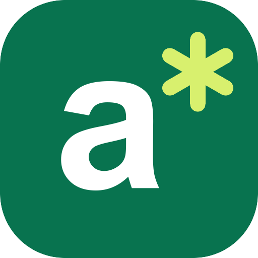

<p align="center">
  
</p>

<h1 align="center">Adseezy MCP Server</h1>

<p align="center">
  Create short video ads, UGC creator ads and ad hooks for your own products,<br>
  right from ChatGPT, Claude, Cursor or VS Code.
</p>

<p align="center">
  <a href="https://adseezy.com">Website</a> ·
  <a href="https://adseezy.com/ai-assistants">Setup guide</a> ·
  <a href="https://adseezy.com/pricing">Pricing</a> ·
  <a href="mailto:support@adseezy.com">Support</a>
</p>

---

[Adseezy](https://adseezy.com) turns a photo of your product into vertical video ads for TikTok, Instagram Reels and Meta. It also writes ad hooks and UGC scripts from a product page.

This is a **hosted (remote) MCP server**. There is nothing to install or run. You add one URL to your AI assistant and sign in with your Adseezy account.

```
https://adseezy.com/mcp
```

- **Transport:** Streamable HTTP
- **Auth:** OAuth 2.1. You sign in with your Adseezy account; no API key needed.
- **Spec:** MCP 2026-07-28. Earlier 2025 clients are supported too.

## Install

### Claude (web and desktop)
1. Open **Settings → Connectors → Add custom connector**.
2. Name it **Adseezy** and paste `https://adseezy.com/mcp`.
3. Click **Connect**, sign in to Adseezy and click **Allow**.

### ChatGPT
1. Open **Settings → Apps & Connectors → Advanced settings** and turn on **Developer mode**.
2. Click **Create**, name it **Adseezy**, paste `https://adseezy.com/mcp` and choose **OAuth**.
3. Sign in to Adseezy and click **Allow**.

### Cursor
One-click install: open [adseezy.com/ai-assistants](https://adseezy.com/ai-assistants) and click **Install in Cursor**.

Or add this to `~/.cursor/mcp.json`:
```json
{
  "mcpServers": {
    "adseezy": { "url": "https://adseezy.com/mcp" }
  }
}
```

### VS Code
Add this to your MCP settings:
```json
{
  "servers": {
    "adseezy": { "type": "http", "url": "https://adseezy.com/mcp" }
  }
}
```

### Claude Code
```bash
claude mcp add --transport http adseezy https://adseezy.com/mcp
```

## Tools

| Tool | What it does | Credits |
|---|---|---|
| `get_account` | Your credit balance and plan | Free |
| `list_ad_formats` | The 10 Ad Studio formats (UGC review, unboxing, studio shoot, lifestyle, cinematic…), with durations and costs | Free |
| `list_styles` | The style library for product and UGC creator videos, filterable by tool, category or search | Free |
| `estimate_cost` | The exact cost of a planned video, ad or hook run | Free |
| `generate_hooks` | 10 hooks, 3 UGC scripts (10/20/30 s), a caption and hashtags from a product link or description | 30 |
| `create_ad` | Starts an Ad Studio video ad from 1–5 product photos or a product page | Shown first |
| `create_video` | Starts a style-based product video or UGC creator video | Shown first |
| `get_video` | Status and progress, plus the MP4 link when the video is ready | Free |
| `list_videos` | Your recent videos | Free |

For `create_ad` and `create_video`, the first call returns the cost and charges nothing. The video starts only when the call is repeated with the agreed cost. Videos take a few minutes.

## Example prompts

- *"Write TikTok hooks and UGC scripts for https://yourstore.com/products/serum."*
- *"Show me the Adseezy ad formats and what they cost."*
- *"Make a 10-second UGC review ad for this product photo. Tell me the cost first."*
- *"Is my last video ready? Send me the MP4 link."*

## Credits and pricing

Generations use credits from your Adseezy balance. Credits and plans are bought on [adseezy.com/pricing](https://adseezy.com/pricing), never inside the assistant. Failed generations return their credits automatically.

## Safety and limits

- **Moderation:** every prompt and script is screened by content moderation before anything is generated or charged.
- **Your own products:** every generation starts from your own product. There are no face swaps, deepfakes or voice cloning, and no sexual content, celebrities or minors. See the [Acceptable Use Policy](https://adseezy.com/acceptable-use).
- **Per-connection limits:** each connected assistant has a daily credit limit (5,000 by default), at most 3 videos generating at once, and a request rate limit.
- **Control:** change limits or disconnect any assistant under **Connected apps** in your [dashboard](https://adseezy.com/dashboard).

## Links

- [Privacy Policy](https://adseezy.com/privacy)
- [Terms of Service](https://adseezy.com/terms)
- [Acceptable Use Policy](https://adseezy.com/acceptable-use)
- Support: [support@adseezy.com](mailto:support@adseezy.com)

---

This repository holds the public documentation and registry metadata for the hosted Adseezy MCP server. The server itself is operated by Adseezy and isn't open source.
